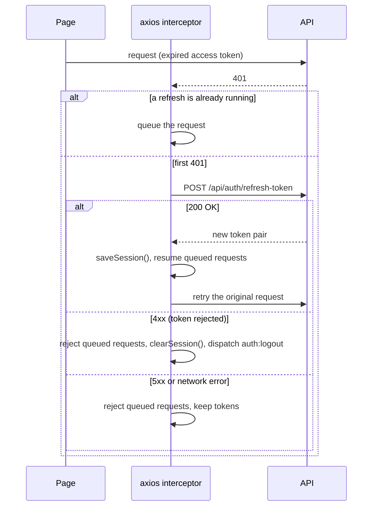

# ClinicFlow Frontend — Architecture

How the React app is put together: startup, routing, the API layer, authentication, error handling, and the UI system. For what each page does, see [FEATURES.md](FEATURES.md). For setup and day-to-day work, see [DEVELOPMENT.md](DEVELOPMENT.md). For the API itself, see [API_CONTRACT.md](API_CONTRACT.md).

---

## 1. Overview

| Concern | Technology |
|---|---|
| UI library | React 19 |
| Language | TypeScript 5.9 (`strict`) |
| Build / dev server | Vite 7 (dev server on port 3000) |
| Routing | react-router-dom 7, `HashRouter` |
| Styling | Tailwind CSS 3 with CSS-variable theme tokens |
| Components | shadcn/ui ("new-york" style) on Radix UI primitives |
| HTTP | axios, with interceptors for auth and token refresh |
| Feedback | sonner toasts |
| Icons | lucide-react |
| Dates | date-fns |
| Tests | Vitest, Testing Library, jsdom |

There is no global state library and no data-fetching library. Authentication is the only shared state (a React context); every page loads its own data.

### Folder map

```
src/
├── main.tsx           Entry point: HashRouter, global CSS, Radix body-style workaround
├── App.tsx            All routes and the layout routes: AppLayout (picks the shell), ProtectedRoute, GuestOnlyRoute
├── index.css          Tailwind layers, theme tokens, global layout rules
├── api/               axios instance + one module per API resource
├── context/           AuthContext (session state, login/logout)
├── components/        Shared components (Navbar and Footer for visitors, StatusBadge, …)
│   ├── shell/         Signed-in app shell: AppShell (sidebar + top bar), NotificationsMenu
│   └── ui/            shadcn/ui primitives, restyled for the design system
├── hooks/             use-api-query (page data loading), use-unread-notifications
├── lib/               Shared helpers: utils (cn), api-error, appointments, navigation, chunk-reload
├── pages/             One component per route
└── types/             TypeScript types for API requests and responses
```

## 2. Startup

1. **`index.html`** loads `src/main.tsx`.
2. **`src/main.tsx`**:
   - renders `<App />` inside `<React.StrictMode>` and `<HashRouter>`, and imports `index.css`;
   - reloads the page once when a lazy chunk from an older deploy can't be fetched (`vite:preloadError`, see `lib/chunk-reload.ts`);
   - installs a `MutationObserver` on `<body>`. Radix menus and dialogs set `pointer-events: none` and `padding-right` on the body while open, which shifted the page layout. The observer removes those two styles. `index.css` adds matching rules (an always-visible scrollbar gutter, and `body[style] { padding-right: 0 }`). Keep both if you change dialogs or menus.
3. **`src/App.tsx`** wraps everything in `<AuthProvider>`, renders the routes, and mounts the global `<Toaster position="top-right" richColors />`.

## 3. Routing

All routes are declared in `src/App.tsx`, nested under one **layout route**, `AppLayout`, which renders the matched page through `<Outlet />`. Because it is a parent route, the shell stays mounted while the user navigates: the sidebar, the account menu and the unread-notification state aren't rebuilt on every page change. `AppLayout` provides:
- a "Skip to content" link (visible on keyboard focus);
- for **signed-in users**, `components/shell/AppShell`: a fixed sidebar (a slide-in sheet below `lg`), a sticky top bar with the notification bell and account menu, and a slim footer ([§9](#app-shell));
- for **visitors**, the sticky top `Navbar` and the full `Footer`;
- the page inside `<main id="main-content">`, wrapped in an `ErrorBoundary` (keyed by route, so navigating away clears a crash) and `Suspense`.

Access rules are nested layout routes inside it: `ProtectedRoute` (signed-in pages, optionally limited to roles) and `GuestOnlyRoute` (sign-in and sign-up pages).

While the session is being restored, `AppLayout` shows a loading state instead of either shell and doesn't render the routes, so the guards below never redirect before the session is known. `AppLayout` also scrolls to the top on every route change, because hash routing keeps the previous scroll position.

**Code splitting:** `LandingPage` is imported eagerly for the fastest first paint. Every other page is loaded with `React.lazy` through the small `page()` helper in `App.tsx`, so each page is its own chunk. When adding a page, register it the same way.

| Path | Page component | Access | Purpose |
|---|---|---|---|
| `/` | `LandingPage` | Public | Marketing landing page |
| `/doctors` | `DoctorsPage` | Public | Search and filter doctors |
| `/doctors/:id` | `DoctorDetailsPage` | Public | Doctor profile and reviews |
| `/login` | `LoginPage` | Signed-out only | Sign in |
| `/register/patient` | `RegisterPatientPage` | Signed-out only | Patient registration |
| `/register/doctor` | `RegisterDoctorPage` | Signed-out only | Doctor registration (needs admin approval) |
| `/forgot-password` | `ForgotPasswordPage` | Signed-out only | Request a reset email |
| `/reset-password` | `ResetPasswordPage` | Public | Set a new password from the email link |
| `/confirm-email` | `ConfirmEmailPage` | Public | Confirm the account from the email link |
| `/patient/appointments` | `PatientAppointmentsPage` | Patient | List, cancel and review appointments |
| `/patient/book/:doctorId` | `BookAppointmentPage` | Patient | Pick a date and slot and book |
| `/patient/profile` | `PatientProfilePage` | Patient | Personal and medical information |
| `/doctor/dashboard` | `DoctorDashboardPage` | Doctor | Today's appointments and weekly schedule |
| `/doctor/appointments` | `DoctorAppointmentsPage` | Doctor | List, complete and annotate appointments |
| `/doctor/schedules` | `DoctorSchedulesPage` | Doctor | Weekly availability |
| `/doctor/profile` | `DoctorProfilePage` | Doctor | Personal and professional information |
| `/admin/dashboard` | `AdminDashboardPage` | Admin | Platform statistics and charts |
| `/admin/pending-doctors` | `AdminPendingDoctorsPage` | Admin | Approve or reject doctors |
| `/admin/specialties` | `AdminSpecialtiesPage` | Admin | Manage specialties |
| `/notifications` | `NotificationsPage` | Any signed-in user | Notification inbox |
| `*` | `NotFoundPage` | Public | 404 |

### Why hash routing

The app uses `HashRouter`, so URLs look like `http://localhost:3000/#/doctors`. **Don't switch to `BrowserRouter` on its own.** The backend builds the links in its emails as `/#/confirm-email?userId=…&token=…` and `/#/reset-password?userId=…&token=…` (contract [§8](API_CONTRACT.md#8-frontend-routes-the-backend-depends-on)). Changing the routing means changing the backend's `EmailService` at the same time.

### `ProtectedRoute` and `GuestOnlyRoute`

```tsx
<Route element={<ProtectedRoute roles={['Doctor']} />}>
  <Route path="/doctor/dashboard" element={<DoctorDashboardPage />} />
</Route>
```

`ProtectedRoute`:
- If the user isn't signed in, it redirects to `/login` with `state.from` set to the requested path.
- If `roles` is given and the user's role isn't in it, it redirects to that role's home page (`homeByRole` in `src/lib/navigation.ts`).
- With no `roles`, any signed-in user is allowed (used for `/notifications`).

`GuestOnlyRoute` wraps `/login`, `/register/*` and `/forgot-password`. A signed-in user who opens one of them is sent on to where they belong. `/reset-password` and `/confirm-email` stay open to everyone because they are opened from email links.

Both use `postLoginPath(role, from)`: it returns `from` (the page the user originally asked for) when their role can open it, and otherwise their role's home: Admin → `/admin/dashboard`, Doctor → `/doctor/dashboard`, Patient → `/patient/appointments`.

The role check only controls what the UI shows. The backend enforces every permission itself.

## 4. API layer

### The axios instance (`src/api/axios.ts`)

- **Base URL:** `` `${import.meta.env.VITE_API_URL ?? ''}/api` ``. When `VITE_API_URL` is empty, requests go to the same origin (`/api/...`), which is what the Docker/nginx setup expects. See [DEVELOPMENT.md](DEVELOPMENT.md#2-configuration) for local values.
- **Timeout:** 20 seconds, so a hung backend ends in an error the page can show instead of an endless spinner.
- **Request interceptor:** adds `Authorization: Bearer <accessToken>` when a token exists.
- **Response interceptor:** handles 401s by refreshing the token (see [§5](#5-authentication-and-session)).

### Resource modules

Each file in `src/api/` exports one plain object of typed functions. `src/api/index.ts` re-exports them all, so pages import from `@/api`:

```ts
import { appointmentsApi } from '@/api';
const res = await appointmentsApi.getMyAppointments({ pageNumber: 1, pageSize: 10 });
```

| Module | File | Endpoints (paths are under `/api`) |
|---|---|---|
| `authApi` | `auth.ts` | `auth/login`, `auth/register/patient`, `auth/register/doctor`, `auth/confirm-email`, `auth/refresh-token`*, `auth/logout`, `auth/forgot-password`, `auth/reset-password` |
| `doctorsApi` | `doctors.ts` | `GET doctors`, `GET doctors/{id}`, `GET doctors/{id}/slots`, `GET doctors/{id}/reviews`*, `PUT doctors/profile`, `GET/POST doctors/schedule`, `PUT/DELETE doctors/schedule/{id}` |
| `appointmentsApi` | `appointments.ts` | `POST appointments`, `GET appointments/my`, `GET appointments/doctor/my`, `GET appointments/{id}`*, `POST appointments/{id}/cancel`, `POST appointments/{id}/complete`, `PUT appointments/{id}/notes` |
| `reviewsApi` | `reviews.ts` | `POST reviews`, `GET reviews/doctor/{doctorId}`, `DELETE reviews/{id}`* |
| `notificationsApi` | `notifications.ts` | `GET notifications/my?unreadOnly=`, `POST notifications/{id}/read`, `POST notifications/read-all` |
| `specialtiesApi` | `specialties.ts` | `GET specialty`, `GET specialty/{id}`* |
| `adminApi` | `admin.ts` | `GET admin/doctors/pending`, `POST admin/doctors/{id}/approve`, `POST admin/doctors/{id}/suspend`, `GET/POST admin/specialties`, `PUT/DELETE admin/specialties/{id}`, `GET admin/stats/overview`, `GET admin/stats/appointments` |
| `profileApi` | `profile.ts` | `GET profile/me`, `PATCH profile/me` |
| `patientApi` | `patient.ts` | `GET patients/profile`, `PATCH patients/profile` |

\* Defined but not called by any page today. The token refresh in `axios.ts` calls the endpoint directly with a plain axios request, so the interceptor doesn't run on its own refresh call.

Request and response details, validation rules and error codes for every endpoint are in [API_CONTRACT.md §4–§5](API_CONTRACT.md#4-endpoint-index).

## 5. Authentication and session

### Tokens and storage

The backend issues a short-lived **access token** (JWT, 15 minutes) and a **refresh token** (7 days, single use: every refresh returns a new pair). See contract [§2](API_CONTRACT.md#2-authentication-and-sessions).

The session lives in two places:
- **Memory:** module variables in `axios.ts` (`accessToken`, `refreshTokenValue`), used by the interceptors.
- **`localStorage`:** so the session survives a page reload. It uses six keys: `accessToken`, `refreshToken`, `expiresAt`, `userRole`, `userName`, `userEmail`.

Two helpers in `axios.ts` keep these in sync. Always use them instead of touching `localStorage` directly:
- `saveSession(loginResponse)` stores both tokens in memory and all six keys.
- `clearSession()` forgets the tokens and removes only those six keys.

### Signing in

`AuthContext.login(email, password)`:
1. calls `authApi.login`;
2. calls `saveSession(response)`;
3. loads the user's profile with `profileApi.getMyProfile()`. If that fails with a 4xx, the session is cleared again and the error is shown. If it fails with a network error or 5xx, the sign-in still succeeds with `user = null`, as on page load;
4. sets `isAuthenticated`, `role` and `user`, and returns the role.

`LoginPage` then navigates to `postLoginPath(role, from)` ([§3](#protectedroute-and-guestonlyroute)).

### Restoring the session on page load

`AuthContext.initAuth` runs once when the app starts:
- If `accessToken`, `refreshToken` and `userRole` are all in `localStorage`, it loads the tokens and calls `GET /profile/me`. An expired access token is refreshed automatically by the interceptor.
  - **Success:** the user is signed in.
  - **4xx response:** the session is invalid, so it is cleared.
  - **Network error or 5xx:** the session is **kept**. The user stays signed in with `user = null`, and the profile loads with a later request.
- Otherwise the user is signed out.

`isLoading` stays `true` until this finishes, and `AppLayout` shows a spinner until then.

### Token refresh (single-flight)

When any request returns 401, the response interceptor refreshes the token **once**, even if many requests fail at the same moment. That's required, because refresh tokens are single use (contract [§2.3](API_CONTRACT.md#23-refresh-rules-frontend-must-follow-these)).



### Several tabs

All tabs share `localStorage`, but each keeps its own copy of the tokens in memory. Without coordination, two tabs refreshing with the same token would make one of them reuse an already-rotated refresh token. The API rejects that, and reuse from another IP or more than 5 minutes later **revokes every session of the user** (contract [§2.3](API_CONTRACT.md#23-refresh-rules-frontend-must-follow-these)). So:
- **One refresh at a time across tabs:** the refresh runs inside a Web Lock (`navigator.locks`, lock name `clinicflow:refresh-token`).
- **Reuse another tab's refresh:** inside the lock, the tab reads the tokens from `localStorage` again. If another tab has already stored a newer access token that hasn't expired, it uses that one and doesn't call the API. Otherwise it refreshes with the stored refresh token, which is always the newest.
- **Stay in sync:** a `storage` listener in `axios.ts` copies new tokens into memory when another tab signs in or refreshes, and ends this tab's session when another tab signs out. `AuthContext` re-runs `initAuth` when another tab signs in.

More rules:
- A request is retried **once**. If the retry also gets a 401, the session is ended.
- A 401 with no refresh token in memory (for example, a wrong password on the login page) also ends the session. For a signed-out user, that only means a redirect to `/login`.

### `auth:logout` event

`axios.ts` can't use React hooks, so when it ends a session it dispatches a `window` event named `auth:logout`. `AuthProvider` listens for it, resets its state and navigates to `/login`.

### Signing out

`AuthContext.logout()`:
1. calls `POST /api/auth/logout` with the refresh token, so the server revokes it (errors are ignored);
2. calls `clearSession()`;
3. resets the state and navigates to `/`.

## 6. Error handling

The API returns errors in several shapes (contract [§3](API_CONTRACT.md#3-errors)):
- **ProblemDetails:** `title` is an *error code* such as `Appointment.SlotAlreadyBooked`, and `detail` is a sentence.
- **Validation errors:** `title` is a generic "One or more validation errors occurred.", and `errors` maps field names or error codes to messages.
- **ProblemDetails without a code** (since contract 3.0.0, before that an empty body): for 401 and 403 from the middleware, unknown routes and unhandled 500s. `title` is a reason phrase such as `"Unauthorized"`, which `api-error.ts` doesn't treat as a code, so the caller's fallback text is shown.

**Never show `err.response.data.title` to users.** Use the helpers in `src/lib/api-error.ts`:

| Function | Returns | Use it for |
|---|---|---|
| `getApiErrorMessage(err, fallback)` | One user-facing sentence | Most toasts |
| `getApiErrorMessages(err, fallback)` | Every message, e.g. all validation errors | Registration forms (one toast per message) |
| `getApiErrorCode(err)` | The error code, or `undefined` | Logic that branches on a specific error |

```ts
try {
  await appointmentsApi.cancel(id, { cancellationReason });
} catch (err) {
  toast.error(getApiErrorMessage(err, 'Failed to cancel'));
}
```

How the message is chosen, in order:
1. no response at all → "Could not reach the server…";
2. a known error code → friendly text from the table in `api-error.ts`;
3. the response's `detail`;
4. the validation messages;
5. 403 → "You do not have permission…";
6. the fallback you passed in.

When the backend adds an error code, add its message to `messagesByCode` in `api-error.ts`.

## 7. Data fetching and state

- **Page-local state:** pages load their data with `useApiQuery` (`src/hooks/use-api-query.ts`) and keep form and dialog state in `useState`:

  ```ts
  const { data, loading, error, reload, setData } = useApiQuery(
    () => appointmentsApi.getMyAppointments({ status, pageNumber, pageSize: 10 }).then((res) => res.data),
    `${status}|${pageNumber}` // key: every input of the request; a new key loads again
  );
  ```

  - `loading` is true until the response for the current key arrives. Responses for an older key are ignored, so fast filter or date changes can't show stale data.
  - `error` is set when the request fails. Show `<ErrorState message={getApiErrorMessage(error, …)} onRetry={reload} />`, never an empty state, so a failed load doesn't look like "no data".
  - After a change (cancel, create, etc.) call `reload()`, or update the loaded data locally with `setData`.
- **Shared state:** only the auth context (`AuthProvider` in `context/AuthContext.tsx`; `useAuth()` from `context/auth-context.ts` returns `isAuthenticated`, `role`, `user`, `userName`, `isLoading`, `login`, `logout`, `refreshUser`).
- **Ignoring out-of-date responses:** `useApiQuery` does this for you. `DoctorsPage` still uses the older manual pattern, numbering each request with a `useRef` counter and ignoring any response that isn't the latest:

  ```ts
  const requestId = useRef(0);
  const load = async () => {
    const current = ++requestId.current;
    const res = await api.call();
    if (current !== requestId.current) return; // a newer request has started
    setData(res.data);
  };
  ```
- **Feedback:** success and failure messages use `toast` from `sonner`.
- **Paging:** list endpoints return a bare array. Pages ask for a fixed `pageSize` and assume there's another page when the array is full. Notifications and pending doctors also send the total in an `X-Total-Count` header (contract 3.0.0), which the app doesn't read yet ([KNOWN_ISSUES.md](KNOWN_ISSUES.md)).

## 8. Shared helpers and types

| File | Contents |
|---|---|
| `src/lib/utils.ts` | `cn(...classes)`: merges Tailwind class names (clsx + tailwind-merge, extended with the custom type scale and shadows) |
| `src/lib/api-error.ts` | API error helpers ([§6](#6-error-handling)) |
| `src/lib/appointments.ts` | `hasAppointmentStarted(appointment)`: whether the start time has passed (decides when "Complete" is offered). `canPatientCancel(appointment)`: confirmed and at least `PATIENT_CANCELLATION_WINDOW_HOURS` (2) before the start |
| `src/lib/chunk-reload.ts` | `isChunkLoadError`, `reloadOnceForChunkError()`: reload once (at most every 30 seconds) when a chunk from an older deploy is missing |
| `src/lib/format.ts` | Display helpers: `formatTime` ("9:30 AM"), `formatTimeRange`, `formatDate`, `parseUtc` (adds the missing `Z`), `formatTimeAgo`, `formatFee` ("650 EGP"), `getInitials` (ignores "Dr.") |
| `src/lib/notifications.ts` | `notifyNotificationsChanged()`: tells the notification bell to refresh after notifications are marked read |
| `src/lib/navigation.ts` | Navigation per role (`navByRole`, `profileNavByRole`, `notificationsNavItem`), `appointmentsRouteByRole`, `workspaceLabelByRole`, `homeByRole`, `postLoginPath(role, from)` |
| `src/lib/password.ts` | The server's password rules (`passwordRules`, `meetsPasswordRules`) for live checklists |
| `src/types/index.ts` | Request/response types and enums (`UserRole`, `AppointmentStatus`, `DayOfWeek`, `BloodType`, …) |

### Types

The types follow contract [§6–§7](API_CONTRACT.md#6-data-types). Enums are **string unions** (for example, `type DayOfWeek = 'Sunday' | … | 'Saturday'`), because the API sends enums as strings and `tsconfig` forbids TypeScript `enum`s. Some types still differ slightly from the contract; see [KNOWN_ISSUES.md](KNOWN_ISSUES.md).

### Dates and times

| Value | Format | How to treat it |
|---|---|---|
| Dates (`appointmentDate`, slot `date`) | `yyyy-MM-dd` | Parse with `parseISO`; it's a local date |
| Slot and schedule times | `HH:mm:ss` (send `HH:mm` or `HH:mm:ss`) | Clinic wall-clock time. Display with `formatTime`/`formatTimeRange`; don't convert time zones |
| Timestamps (`createdAt`, `bookedAt`, …) | UTC, **often without a `Z`** | Parse with `parseUtc`, never `new Date()` or `parseISO` directly |

## 9. UI system

The design system is **Clinical Sanctuary**, from the Stitch design export (`clinical_sanctuary/DESIGN.md` plus four reference screens), kept locally in `design/` and git-ignored. It aims for a calm, low-friction clinical workspace:
- a cool, softly blue-tinted canvas;
- **tonal layering**: surfaces step from `background` to `muted` to `accent` to `secondary` instead of relying on heavy shadows;
- white cards with a hairline border and an ambient shadow;
- eucalyptus green for actions and deep slate for structure.

The Stitch HTML is a visual reference only. None of it is copied into the app.

### Design tokens

All colors are HSL channel triplets in `src/index.css` (`:root`), mapped in `tailwind.config.js` as `hsl(var(--name) / <alpha-value>)`, so **every color supports opacity modifiers** (`bg-primary/90`, `ring-ring/20`, `bg-destructive/[0.06]`). Use the tokens, not raw Tailwind palettes (`teal-600`, `slate-500`), and no decorative gradients.

| Token | Value | Use |
|---|---|---|
| `primary` | Eucalyptus `#006C4A` | Primary buttons, links, selected chips and dates, focus, the "active" dot. Stitch calls this its *secondary* color. It is our `primary` because it is the interactive color everywhere in the screens |
| `ink` | Deep medical slate `#0F172A` | Logo mark, `strong` buttons for structural "create" actions, step numbers, the Doctor role badge, the landing call-to-action panel |
| `background` | `#F8F9FF` | App canvas |
| `card` / `popover` | `#FFFFFF` | Cards, dialogs, menus |
| `muted` | `#EFF4FF` | Tonal fills inside cards (fact tiles, notes, sidebar background) |
| `accent` | `#E5EEFF` | Hover fill |
| `secondary` | `#DCE9FF` + `#131B2E` text | Icon tiles, avatars, tonal (`secondary`) buttons, date tiles |
| `foreground` / `muted-foreground` | `#0B1C30` / `#475569` | Body text / secondary text (7.6:1 on white) |
| `border` / `input` / `ring` | `#E2E8F0` / `#CBD5E1` / `#059669` | Hairlines (cards use `border-border/70`) / control borders / focus ring |
| `success` / `warning` / `info` / `destructive` | `#047857` / `#92400E` / `#0369A1` / `#BA1A1A` | Semantic states. Use as text on a 6–10% tint of themselves (`bg-success/10 text-success`); all pass WCAG AA on their own tint |
| `violet` | `#6B21A8` | Admin role badge only |
| `sidebar-*` | `muted` background, `#D3E4FE` active item | App shell sidebar |

`.dark` holds a matching dark palette, but nothing switches it on yet.

### Typography

- **Plus Jakarta Sans** (`font-display`, weights 600/700) for page titles, card and panel headings, names and big numbers.
- **Inter** (`font-sans`, the body default) for everything else.
- Both fonts are loaded in `index.html` with `preconnect`.

The Stitch type scale is available as Tailwind font sizes. Each size sets its own line height, letter spacing and default weight; a `font-*` class can still override the weight.

| Class | Size / line height | Typical use |
|---|---|---|
| `text-display-lg`, `text-display-md` | 40/48, 32/40, bold | Landing hero, 404 |
| `text-headline-xl` | 30/38, bold | Page titles (`PageHeader`) on desktop, big stat values |
| `text-headline-lg` | 24/32, semibold | Page titles on mobile, profile names |
| `text-headline-md` | 20/28, semibold | Section and panel headings (`Section`, dialog titles) |
| `text-title-sm` | 16/24, semibold | Card titles (`CardTitle`), list item names |
| `text-body-lg` / `-md` / `-sm` | 16/26, 14/22, 12/18 | Body copy, descriptions, hints |
| `text-label-md` | 13/16, semibold | Form labels, nav items, filter tabs |
| `text-label-sm` | 11/14, semibold, tracked | Status chips, eyebrows |
| `text-caption` | 11/16 | Fine print, fact-tile labels |

- The `.eyebrow` class is the small uppercase section label ("TODAY'S PATIENTS"). It's a component-layer class, so put it on plain elements. On `Label`, which sets its own size, use `text-label-sm uppercase tracking-[0.08em] text-muted-foreground` instead.
- `cn()` (`src/lib/utils.ts`) is configured with these font sizes and the custom shadows. Without that, tailwind-merge would read `text-label-md` as a text color and drop it next to `text-foreground`. Add any new scale step there too.
- Tables and `<time>` elements use tabular figures globally. Add `tabular-nums` to other numbers that change or line up.

### Shape, depth and motion

- **Radius** (`--radius` is 10px):
  - controls and buttons use `rounded-lg` (10px);
  - inner panels and tiles use `rounded-xl` (12px);
  - cards and dialogs use `rounded-2xl` (16px);
  - chips, badges and pills use `rounded-full`.
- **Shadows** are slate-tinted and low-opacity:
  - `shadow-xs` for controls;
  - `shadow-card` for cards;
  - `shadow-hover` for hovered link cards;
  - `shadow-elevated` for menus and dialogs.
- **Overlays:** dialogs and sheets use a blurred `bg-ink/40` overlay.
- **Motion:** there is no animation library. `index.css` neutralizes CSS animations under `prefers-reduced-motion`. The landing page's scroll reveal (`Reveal`) uses an `IntersectionObserver` and keeps its hidden start state behind `motion-safe:`, so content is simply visible when reduced motion is preferred.

### App shell

`AppLayout` in `App.tsx` chooses the shell. It waits for the session restore first, so signed-in users don't see the visitor navbar flash.

- **Signed-in users:** `components/shell/AppShell`.
  - A fixed 256px sidebar (`w-sidebar`) on `lg` and up. It holds the logo, the role navigation, an "Account" group with Notifications (unread count) and Profile, and a user card with role badge and Sign out.
  - Below `lg`, the same sidebar opens in a left `Sheet` from the top bar's menu button.
  - The sticky, translucent top bar shows the workspace name and role pill, the notification bell (`shell/NotificationsMenu`) and the account menu. A slim footer closes the column.
- **Visitors:** the top `Navbar` (Find doctors, Sign in, Create account, mobile sheet) and the full `Footer`.
- **Navigation data** lives in `src/lib/navigation.ts`:
  - `navByRole`, `profileNavByRole`, `notificationsNavItem`;
  - `appointmentsRouteByRole`, where a notification about an appointment takes each role;
  - `workspaceLabelByRole`.
- **Unread notifications:** `src/hooks/use-unread-notifications.ts` polls them. It refreshes on navigation, on focus, when the tab becomes visible, every 60 seconds while it is visible (hidden tabs don't poll), and on `notifyNotificationsChanged()`.
- **Errors:** every page is wrapped in an `ErrorBoundary`, keyed by route. A render crash shows a recoverable error instead of a blank screen, and navigating away clears it. A failed page-chunk download (an open tab after a new deploy) reloads the app once instead.

### Shared components

Build pages from these instead of re-styling raw elements:

| Component | Purpose |
|---|---|
| `layout/Page` — `Page`, `PageHeader`, `Section` | Page container (widths `narrow`/`default`/`wide`/`full`). The title block has an optional back link, an uppercase eyebrow in `primary`, a display title, a description and actions |
| `layout/AuthLayout` | Two cards on the canvas, as in the Stitch sign-in screen. The brand card (sticky, `lg` and up) holds the logo, tagline and "Why ClinicFlow" points; the form card holds title, form and footer links |
| `states` — `LoadingState`, `EmptyState`, `ErrorState` | Loading, "nothing here" with a next step, and failed loads with retry |
| `ErrorBoundary` | Route-level crash fallback (used by `AppLayout`) |
| `form/Field`, `FieldGroup` | Label + control + hint/error (with an icon). Wires `id`, `aria-describedby` and `aria-invalid` to the control |
| `form/IconInput` | Input with a decorative leading icon (mail, phone). Works as a `Field` child |
| `form/PasswordInput`, `form/PasswordRequirements` | Password with a lock icon and an accessible show/hide toggle; live rules checklist |
| `form/FormAlert` | Form-level error (`role="alert"`) |
| `StatusBadge` | Appointment status pill: dot + text. Confirmed is green, Completed blue, Pending amber, Cancelled red, No-show grey |
| `RoleBadge` | Role pill: Doctor slate, Patient cyan, Admin violet |
| `UserAvatar` | Initials avatar; shows `src` (profile picture) when given and falls back to initials if it fails to load |
| `DateTile` | Calendar-style date (`<time>`) for appointment lists |
| `FilterTabs` | Segmented filter (toggle buttons with `aria-pressed`, optional counts) |
| `Pagination` | Previous/next paging for lists without a total count |
| `StatCard` | Dashboard metric: uppercase label, display-size value, optional `suffix`, `hint`, `progress` bar, `tone`, and `highlight` (accent bottom edge for "needs action") |
| `Rating` — `RatingStars`, `RatingSummary`, `RatingInput` | Read-only stars (eucalyptus), "★ 4.8 / New" summary, accessible 1–5 radio input |
| `Logo` | Slate mark + Plus Jakarta wordmark |
| `profile/PersonalInfoFields`, `profile/ProfileSummary` | Shared parts of the two profile pages |

### Patterns

- **Cards:** `Card` (or `rounded-2xl border border-border/70 bg-card shadow-card`). Inside a card, group secondary information in tonal tiles (`rounded-xl bg-muted`) rather than nested bordered cards.
- **Chips:** pills with a 1px border on a tint: `rounded-full border border-success/25 bg-success/10 text-label-sm text-success`.
- **Available slots** use the cyan "open slot" tint (`border-info/25 bg-info/[0.06] text-info`); the selected slot or date is solid `primary`.
- **Info banners:** `rounded-xl border border-info/15 bg-info/[0.06] text-info`, with an `Info` icon. Warnings use the same recipe with `warning`.

### shadcn/ui primitives

shadcn/ui primitives live in `src/components/ui/`. All of them have been restyled to these tokens and adapted to **Tailwind 3**:
- button, card, dialog, alert-dialog, dropdown-menu;
- input, textarea, label, select, switch;
- sheet, skeleton, sonner, spinner, tabs, badge.

They were generated for Tailwind v4, so v4-only syntax was converted or given a compatibility utility in `index.css`. Examples: `outline-hidden`, `aria-invalid:`, `max-h-(--var)`, `*:[span]:last:`, `*:[svg]:`. The unused template components that shadcn generated were removed with their dependencies. To add one back, generate it with the shadcn CLI and convert its v4 syntax.

- **Buttons:** all are `rounded-lg` and semibold.

  | Variant | Use |
  |---|---|
  | `default` | Eucalyptus; the primary action, one per area |
  | `strong` | Slate; high-emphasis structural actions such as "Add specialty" and "Add hours" |
  | `outline` | Secondary action |
  | `secondary` | Tonal blue, e.g. "Add notes" |
  | `ghost` | Tertiary action or icon button |
  | `destructive` | Confirming a destructive action |
  | `destructive-outline` | Opening a destructive flow, e.g. "Cancel appointment" |
  | `link` | Inline link styled as a button |

  Sizes: `sm` (36px), `default` (40px), `lg` (44px), and `icon*`.
- **Inputs:** 40px high, `rounded-lg`, a `#CBD5E1` border, and a crisp eucalyptus focus ring (border + 1px ring).
- **Switch:** 44×24px, eucalyptus when on.
- **Icons:** `lucide-react`. Icons next to text are `aria-hidden`; icon-only buttons need an `aria-label`.
- **Charts:** none. The admin dashboard's appointment breakdown is a stacked bar built from `div`s with token classes, and its numbers are repeated as text tiles.

## 10. Build and deployment

- **`vite.config.ts`:**
  - `base: './'` (relative asset paths);
  - React plugin;
  - dev server port `3000`;
  - alias `@` → `src` (mirrored in `tsconfig.app.json` `paths`);
  - `manualChunks` puts React, React DOM and the router in a `react` chunk, which changes far less often than app code and so stays cached across deploys.
- **`vitest.config.ts`:** reuses the Vite config and adds the jsdom environment and `src/test/setup.ts` (jest-dom matchers, cleanup, a fresh `localStorage` per test). `npm test` runs the suite.
- **`npm run build`:** runs `tsc -b` (type check, test files included), then `vite build` into `dist/`. The entry chunk is about 261 kB (≈ 86 kB gzipped) plus the 232 kB `react` chunk (≈ 74 kB gzipped). Each other page is its own small chunk (the admin dashboard is about 6 kB now that it draws its breakdown without recharts).
- **`DockerFile`:** two stages. Stage 1 uses `node:22-alpine` to run `npm ci` and `npm run build`. Stage 2 uses `nginx:alpine` to serve `dist/` on port 80.
- **`nginx.conf`:**
  - serves the app with an SPA fallback (`try_files … /index.html`). Missing files under `/assets/` return a real 404 instead;
  - **caching:** `/assets/*` (fingerprinted by Vite) is cached for a year as `immutable`; `index.html` and every other route are `no-cache`, so browsers pick up a new deploy at once. `/api` responses keep the backend's own headers;
  - **gzip** for JS, CSS, JSON and SVG;
  - **security headers:** a Content Security Policy (scripts from `'self'` only, styles and fonts also from Google Fonts, `connect-src 'self'`, no framing), `X-Content-Type-Options`, `X-Frame-Options`, `Referrer-Policy` and `Permissions-Policy`. If the app is ever built with `VITE_API_URL` pointing at another origin, add that origin to `connect-src`;
  - proxies `/api` to `http://backend:8080`, the backend's service name and port in the backend repo's `docker-compose.yml`, passing `X-Real-IP`, `X-Forwarded-For` and `X-Forwarded-Proto`.

  That's why `VITE_API_URL` is left empty for Docker builds.

See [DEVELOPMENT.md](DEVELOPMENT.md#3-running-the-app) for how to build and run the containers.
