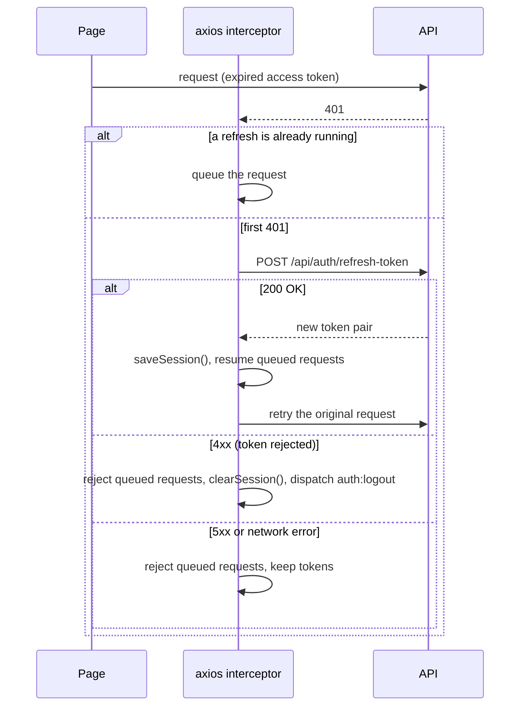

# ClinicFlow Frontend — Architecture

How the React app is put together: startup, routing, the API layer, authentication, error handling, and the UI system. For what each page does, see [FEATURES.md](FEATURES.md). For setup and day-to-day work, see [DEVELOPMENT.md](DEVELOPMENT.md). For the API itself, see [API_CONTRACT.md](API_CONTRACT.md).

---

## 1. Overview

| Concern | Technology |
|---|---|
| UI library | React 19 |
| Language | TypeScript 5.9 (`strict`) |
| Build / dev server | Vite 7 (dev server on port 3000) |
| Routing | react-router-dom 7, `HashRouter` |
| Styling | Tailwind CSS 3 with CSS-variable theme tokens |
| Components | shadcn/ui ("new-york" style) on Radix UI primitives |
| HTTP | axios, with interceptors for auth and token refresh |
| Feedback | sonner toasts |
| Animation / charts / icons | framer-motion, recharts, lucide-react |
| Dates | date-fns |

There is no global state library and no data-fetching library. Authentication is the only shared state (a React context); every page loads its own data.

### Folder map

```
src/
├── main.tsx           Entry point: HashRouter, global CSS, Radix body-style workaround
├── App.tsx            All routes, ProtectedRoute, AppLayout (Navbar + Footer)
├── index.css          Tailwind layers, theme tokens, global layout rules
├── api/               axios instance + one module per API resource
├── context/           AuthContext (session state, login/logout)
├── components/        App components (Navbar, Footer)
│   └── ui/            shadcn/ui components (generated; only some are used)
├── hooks/             use-mobile (from shadcn)
├── lib/               Shared helpers: utils (cn), api-error, appointments
├── pages/             One component per route
└── types/             TypeScript types for API requests and responses
```

## 2. Startup

1. **`index.html`** loads `src/main.tsx`.
2. **`src/main.tsx`**:
   - renders `<App />` inside `<React.StrictMode>` and `<HashRouter>`, and imports `index.css`;
   - installs a `MutationObserver` on `<body>`. Radix menus and dialogs set `pointer-events: none` and `padding-right` on the body while open, which shifted the page layout. The observer removes those two styles. `index.css` adds matching rules (an always-visible scrollbar gutter, and `body[style] { padding-right: 0 }`). Keep both if you change dialogs or menus.
3. **`src/App.tsx`** wraps everything in `<AuthProvider>`, renders the routes, and mounts the global `<Toaster position="top-right" richColors />`.

## 3. Routing

All routes are declared in `src/App.tsx`. Every route is wrapped in `AppLayout`:
- a "Skip to content" link (visible on keyboard focus);
- the sticky `Navbar` (`position: sticky`, so no padding hack is needed);
- the page inside `<main id="main-content">`, wrapped in `Suspense`;
- the `Footer` (full for visitors, a slim bar for signed-in users).

`AppLayout` also scrolls to the top on every route change, because hash routing keeps the previous scroll position.

**Code splitting:** `LandingPage` is imported eagerly for the fastest first paint. Every other page is loaded with `React.lazy` through the small `page()` helper in `App.tsx`, so each page is its own chunk. recharts, for example, only loads with the admin dashboard. When adding a page, register it the same way.

| Path | Page component | Access | Purpose |
|---|---|---|---|
| `/` | `LandingPage` | Public | Marketing landing page |
| `/doctors` | `DoctorsPage` | Public | Search and filter doctors |
| `/doctors/:id` | `DoctorDetailsPage` | Public | Doctor profile and reviews |
| `/login` | `LoginPage` | Public | Sign in |
| `/register/patient` | `RegisterPatientPage` | Public | Patient registration |
| `/register/doctor` | `RegisterDoctorPage` | Public | Doctor registration (needs admin approval) |
| `/forgot-password` | `ForgotPasswordPage` | Public | Request a reset email |
| `/reset-password` | `ResetPasswordPage` | Public | Set a new password from the email link |
| `/confirm-email` | `ConfirmEmailPage` | Public | Confirm the account from the email link |
| `/patient/appointments` | `PatientAppointmentsPage` | Patient | List, cancel and review appointments |
| `/patient/book/:doctorId` | `BookAppointmentPage` | Patient | Pick a date and slot and book |
| `/patient/profile` | `PatientProfilePage` | Patient | Personal and medical information |
| `/doctor/dashboard` | `DoctorDashboardPage` | Doctor | Today's appointments and weekly schedule |
| `/doctor/appointments` | `DoctorAppointmentsPage` | Doctor | List, complete and annotate appointments |
| `/doctor/schedules` | `DoctorSchedulesPage` | Doctor | Weekly availability |
| `/doctor/profile` | `DoctorProfilePage` | Doctor | Personal and professional information |
| `/admin/dashboard` | `AdminDashboardPage` | Admin | Platform statistics and charts |
| `/admin/pending-doctors` | `AdminPendingDoctorsPage` | Admin | Approve or reject doctors |
| `/admin/specialties` | `AdminSpecialtiesPage` | Admin | Manage specialties |
| `/notifications` | `NotificationsPage` | Any signed-in user | Notification inbox |
| `*` | `NotFoundPage` | Public | 404 |

### Why hash routing

The app uses `HashRouter`, so URLs look like `http://localhost:3000/#/doctors`. **Don't switch to `BrowserRouter` on its own.** The backend builds the links in its emails as `/#/confirm-email?userId=…&token=…` and `/#/reset-password?userId=…&token=…` (contract [§8](API_CONTRACT.md#8-frontend-routes-the-backend-depends-on)). Changing the routing means changing the backend's `EmailService` at the same time.

### `ProtectedRoute`

```tsx
<ProtectedRoute allowedRoles={['Doctor']}> … </ProtectedRoute>
```

- While `AuthContext` is still restoring the session (`isLoading`), it shows a spinner.
- If the user isn't signed in, it redirects to `/login` with `state.from` set to the requested path. After signing in, `LoginPage` sends the user back there (otherwise to their role's home page).
- If `allowedRoles` is given and the user's role isn't in it, it redirects to `/`.
- With no `allowedRoles`, any signed-in user is allowed (used for `/notifications`).

The role check only controls what the UI shows. The backend enforces every permission itself.

## 4. API layer

### The axios instance (`src/api/axios.ts`)

- **Base URL:** `` `${import.meta.env.VITE_API_URL ?? ''}/api` ``. When `VITE_API_URL` is empty, requests go to the same origin (`/api/...`), which is what the Docker/nginx setup expects. See [DEVELOPMENT.md](DEVELOPMENT.md#2-configuration) for local values.
- **Request interceptor:** adds `Authorization: Bearer <accessToken>` when a token exists.
- **Response interceptor:** handles 401s by refreshing the token (see [§5](#5-authentication-and-session)).

### Resource modules

Each file in `src/api/` exports one plain object of typed functions. `src/api/index.ts` re-exports them all, so pages import from `@/api`:

```ts
import { appointmentsApi } from '@/api';
const res = await appointmentsApi.getMyAppointments({ pageNumber: 1, pageSize: 10 });
```

| Module | File | Endpoints (paths are under `/api`) |
|---|---|---|
| `authApi` | `auth.ts` | `auth/login`, `auth/register/patient`, `auth/register/doctor`, `auth/confirm-email`, `auth/refresh-token`*, `auth/logout`, `auth/forgot-password`, `auth/reset-password` |
| `doctorsApi` | `doctors.ts` | `GET doctors`, `GET doctors/{id}`, `GET doctors/{id}/slots`, `GET doctors/{id}/reviews`*, `PUT doctors/profile`, `GET/POST doctors/schedule`, `PUT/DELETE doctors/schedule/{id}` |
| `appointmentsApi` | `appointments.ts` | `POST appointments`, `GET appointments/my`, `GET appointments/doctor/my`, `GET appointments/{id}`*, `POST appointments/{id}/cancel`, `POST appointments/{id}/complete`, `PUT appointments/{id}/notes` |
| `reviewsApi` | `reviews.ts` | `POST reviews`, `GET reviews/doctor/{doctorId}`, `DELETE reviews/{id}`* |
| `notificationsApi` | `notifications.ts` | `GET notifications/my?unreadOnly=`, `POST notifications/{id}/read`, `POST notifications/read-all` |
| `specialtiesApi` | `specialties.ts` | `GET specialty`, `GET specialty/{id}`* |
| `adminApi` | `admin.ts` | `GET admin/doctors/pending`, `POST admin/doctors/{id}/approve`, `POST admin/doctors/{id}/suspend`, `GET/POST admin/specialties`, `PUT/DELETE admin/specialties/{id}`, `GET admin/stats/overview`, `GET admin/stats/appointments` |
| `profileApi` | `profile.ts` | `GET profile/me`, `PATCH profile/me` |
| `patientApi` | `patient.ts` | `GET patients/profile`, `PATCH patients/profile` |

\* Defined but not called by any page today. The token refresh in `axios.ts` calls the endpoint directly with a plain axios request, so the interceptor doesn't run on its own refresh call.

Request and response details, validation rules and error codes for every endpoint are in [API_CONTRACT.md §4–§5](API_CONTRACT.md#4-endpoint-index).

## 5. Authentication and session

### Tokens and storage

The backend issues a short-lived **access token** (JWT, 15 minutes) and a **refresh token** (7 days, single use: every refresh returns a new pair). See contract [§2](API_CONTRACT.md#2-authentication-and-sessions).

The session lives in two places:
- **Memory:** module variables in `axios.ts` (`accessToken`, `refreshTokenValue`), used by the interceptors.
- **`localStorage`:** so the session survives a page reload. It uses six keys: `accessToken`, `refreshToken`, `expiresAt`, `userRole`, `userName`, `userEmail`.

Two helpers in `axios.ts` keep these in sync. Always use them instead of touching `localStorage` directly:
- `saveSession(loginResponse)` stores both tokens in memory and all six keys.
- `clearSession()` forgets the tokens and removes only those six keys.

### Signing in

`AuthContext.login(email, password)`:
1. calls `authApi.login`;
2. calls `saveSession(response)`;
3. loads the user's profile with `profileApi.getMyProfile()`;
4. sets `isAuthenticated`, `role` and `user`.

`LoginPage` then sends the user to their home page: Admin → `/admin/dashboard`, Doctor → `/doctor/dashboard`, Patient → `/patient/appointments`.

### Restoring the session on page load

`AuthContext.initAuth` runs once when the app starts:
- If `accessToken`, `refreshToken` and `userRole` are all in `localStorage`, it loads the tokens and calls `GET /profile/me`. An expired access token is refreshed automatically by the interceptor.
  - **Success:** the user is signed in.
  - **4xx response:** the session is invalid, so it is cleared.
  - **Network error or 5xx:** the session is **kept**. The user stays signed in with `user = null`, and the profile loads with a later request.
- Otherwise the user is signed out.

`isLoading` stays `true` until this finishes, which is why `ProtectedRoute` shows a spinner first.

### Token refresh (single-flight)

When any request returns 401, the response interceptor refreshes the token **once**, even if many requests fail at the same moment. That's required, because refresh tokens are single use (contract [§2.3](API_CONTRACT.md#23-refresh-rules-frontend-must-follow-these)).



More rules:
- A request is retried **once**. If the retry also gets a 401, the session is ended.
- A 401 with no refresh token in memory (for example, a wrong password on the login page) also ends the session. For a signed-out user, that only means a redirect to `/login`.

### `auth:logout` event

`axios.ts` can't use React hooks, so when it ends a session it dispatches a `window` event named `auth:logout`. `AuthProvider` listens for it, resets its state and navigates to `/login`.

### Signing out

`AuthContext.logout()`:
1. calls `POST /api/auth/logout` with the refresh token, so the server revokes it (errors are ignored);
2. calls `clearSession()`;
3. resets the state and navigates to `/`.

## 6. Error handling

The API returns errors in several shapes (contract [§3](API_CONTRACT.md#3-errors)):
- **ProblemDetails:** `title` is an *error code* such as `Appointment.SlotAlreadyBooked`, and `detail` is a sentence.
- **Validation errors:** `title` is a generic "One or more validation errors occurred.", and `errors` maps field names or error codes to messages.
- **Empty bodies:** for 401, 403 and some 500s.

**Never show `err.response.data.title` to users.** Use the helpers in `src/lib/api-error.ts`:

| Function | Returns | Use it for |
|---|---|---|
| `getApiErrorMessage(err, fallback)` | One user-facing sentence | Most toasts |
| `getApiErrorMessages(err, fallback)` | Every message, e.g. all validation errors | Registration forms (one toast per message) |
| `getApiErrorCode(err)` | The error code, or `undefined` | Logic that branches on a specific error |

```ts
try {
  await appointmentsApi.cancel(id, { cancellationReason });
} catch (err) {
  toast.error(getApiErrorMessage(err, 'Failed to cancel'));
}
```

How the message is chosen, in order:
1. no response at all → "Could not reach the server…";
2. a known error code → friendly text from the table in `api-error.ts`;
3. the response's `detail`;
4. the validation messages;
5. 403 → "You do not have permission…";
6. the fallback you passed in.

When the backend adds an error code, add its message to `messagesByCode` in `api-error.ts`.

## 7. Data fetching and state

- **Page-local state:** pages load data in `useEffect` and keep it in `useState`, with `loading` and sometimes `error` flags. After a change (cancel, create, etc.) they simply load the list again.
- **Shared state:** only `AuthContext` (`useAuth()` returns `isAuthenticated`, `role`, `user`, `userName`, `isLoading`, `login`, `logout`, `refreshUser`).
- **Ignoring out-of-date responses:** where the user can trigger requests faster than they finish (doctor filters in `DoctorsPage`, the date picker in `BookAppointmentPage`), the page numbers each request with a `useRef` counter and ignores any response that isn't the latest:

  ```ts
  const requestId = useRef(0);
  const load = async () => {
    const current = ++requestId.current;
    const res = await api.call();
    if (current !== requestId.current) return; // a newer request has started
    setData(res.data);
  };
  ```
- **Feedback:** success and failure messages use `toast` from `sonner`.
- **Paging:** list endpoints return a bare array with no total count. Pages ask for a fixed `pageSize` and assume there's another page when the array is full.

## 8. Shared helpers and types

| File | Contents |
|---|---|
| `src/lib/utils.ts` | `cn(...classes)`: merges Tailwind class names (clsx + tailwind-merge) |
| `src/lib/api-error.ts` | API error helpers ([§6](#6-error-handling)) |
| `src/lib/appointments.ts` | `hasAppointmentStarted(appointment)`: whether the start time has passed; used to decide when "Complete" is offered |
| `src/lib/format.ts` | Display helpers: `formatTime` ("9:30 AM"), `formatTimeRange`, `formatDate`, `parseUtc` (adds the missing `Z`), `formatTimeAgo`, `formatFee` ("650 EGP"), `getInitials` (ignores "Dr.") |
| `src/lib/notifications.ts` | `notifyNotificationsChanged()`: tells the Navbar bell to refresh after notifications are marked read |
| `src/lib/password.ts` | The server's password rules (`passwordRules`, `meetsPasswordRules`) for live checklists |
| `src/types/index.ts` | Request/response types and enums (`UserRole`, `AppointmentStatus`, `DayOfWeek`, `BloodType`, …) |

### Types

The types follow contract [§6–§7](API_CONTRACT.md#6-data-types). Enums are **string unions** (for example, `type DayOfWeek = 'Sunday' | … | 'Saturday'`), because the API sends enums as strings and `tsconfig` forbids TypeScript `enum`s. Some types still differ slightly from the contract; see [KNOWN_ISSUES.md](KNOWN_ISSUES.md).

### Dates and times

| Value | Format | How to treat it |
|---|---|---|
| Dates (`appointmentDate`, slot `date`) | `yyyy-MM-dd` | Parse with `parseISO`; it's a local date |
| Slot and schedule times | `HH:mm:ss` (send `HH:mm` or `HH:mm:ss`) | Clinic wall-clock time. Display with `formatTime`/`formatTimeRange`; don't convert time zones |
| Timestamps (`createdAt`, `bookedAt`, …) | UTC, **often without a `Z`** | Parse with `parseUtc`, never `new Date()` or `parseISO` directly |

## 9. UI system

The visual direction is calm, clinical and warm: a deep teal brand color on a warm paper-white background, a serif display face for titles, and restrained depth (thin borders and soft shadows rather than gradients).

### Design tokens

All colors are HSL channel triplets in `src/index.css` (`:root`), mapped in `tailwind.config.js` as `hsl(var(--name) / <alpha-value>)`, so **every color supports opacity modifiers** (`bg-primary/90`, `ring-ring/20`, `bg-destructive/[0.06]`). Use the tokens, not raw Tailwind palettes (`teal-600`, `slate-500`).

| Token | Use |
|---|---|
| `primary` (deep teal) | Primary buttons, links, active navigation, selected states |
| `secondary` | Soft teal tint: avatar backgrounds, icon tiles, selected rows |
| `background` / `card` / `muted` | Warm page background / white surfaces / subtle fills |
| `foreground` / `muted-foreground` | Body text / secondary text |
| `border` / `input` / `ring` | Dividers / form control borders / focus rings |
| `success` / `warning` / `info` / `destructive` | Semantic states; use as text on a 6–10% tint of themselves (e.g. `bg-success/10 text-success`) |

- **Typography:** Inter for UI text; **Fraunces** (`font-display`) for page titles and marketing headlines only. Both are loaded in `index.html` with `preconnect`.
- **Radius:** `--radius` is 10px. Cards use `rounded-xl`, controls `rounded-md`.
- **Shadows:** `shadow-xs` (controls), `shadow-card` (cards), `shadow-elevated` (menus, dialogs, hover).
- **Motion:** `App` wraps everything in `<MotionConfig reducedMotion="user">`, and `index.css` neutralizes CSS animations under `prefers-reduced-motion`. The landing page's scroll reveal renders statically when reduced motion is preferred.

### Shared components

Build pages from these instead of re-styling raw elements:

| Component | Purpose |
|---|---|
| `layout/Page` — `Page`, `PageHeader`, `Section` | Page container (widths `narrow`/`default`/`wide`/`full`), title block with optional back link, eyebrow, description and actions |
| `layout/AuthLayout` | Split layout for sign-in, registration and account recovery |
| `states` — `LoadingState`, `EmptyState`, `ErrorState` | Loading, "nothing here" with a next step, and failed loads with retry |
| `form/Field`, `FieldGroup` | Label + control + hint/error, wiring `id`, `aria-describedby` and `aria-invalid` to the control |
| `form/PasswordInput`, `form/PasswordRequirements` | Password with an accessible show/hide toggle; live rules checklist |
| `StatusBadge` | Appointment status with icon + text (never color alone) |
| `UserAvatar` | Initials avatar |
| `DateTile` | Calendar-style date for appointment lists |
| `FilterTabs` | Segmented filter (toggle buttons with `aria-pressed`) |
| `Pagination` | Previous/next paging for lists without a total count |
| `StatCard` | Dashboard metric |
| `Rating` — `RatingStars`, `RatingSummary`, `RatingInput` | Read-only stars, "★ 4.8 / New" summary, accessible 1–5 radio input |
| `Logo` | Mark + wordmark |
| `profile/PersonalInfoFields`, `profile/ProfileSummary` | Shared parts of the two profile pages |

shadcn/ui primitives live in `src/components/ui/`. The ones in use (button, card, dialog, dropdown-menu, input, label, select, sheet, skeleton, sonner, spinner, switch, tabs, textarea) have been adapted to the tokens and to **Tailwind 3**. They were generated for Tailwind v4, so v4-only syntax such as `outline-hidden`, `aria-invalid:` and `max-h-(--var)` was converted or given a compatibility utility in `index.css`. The other files in `ui/` are unused template components.

- **Buttons:** `default` (primary action, one per area), `outline` (secondary), `ghost` (tertiary/icon), `destructive` (confirming a destructive action), `destructive-outline` (opening a destructive flow, e.g. "Cancel appointment"), `link`. Sizes `sm` (36px), `default` (40px), `lg` (44px), and `icon*`.
- **Icons:** `lucide-react`. Icons next to text are `aria-hidden`; icon-only buttons need an `aria-label`.
- **Charts:** `recharts`, only on the admin dashboard. Chart colors are hex copies of the tokens, because SVG attributes can't read CSS variables.

## 10. Build and deployment

- **`vite.config.ts`:**
  - `base: './'` (relative asset paths);
  - React plugin;
  - dev server port `3000`;
  - alias `@` → `src` (mirrored in `tsconfig.app.json` `paths`).
- **`npm run build`:** runs `tsc -b` (type check), then `vite build` into `dist/`. The main bundle is about 610 kB (≈ 200 kB gzipped). Each other page is its own chunk; the largest is the admin dashboard (about 375 kB, mostly recharts).
- **`DockerFile`:** two stages. Stage 1 uses `node:20-alpine` to run `npm ci` and `npm run build`. Stage 2 uses `nginx:alpine` to serve `dist/` on port 80.
- **`nginx.conf`:**
  - serves the app with an SPA fallback (`try_files … /index.html`);
  - proxies `/api` to `http://backend:8080`, the backend's service name and port in the backend repo's `docker-compose.yml`.

  That's why `VITE_API_URL` is left empty for Docker builds.

See [DEVELOPMENT.md](DEVELOPMENT.md#3-running-the-app) for how to build and run the containers.
