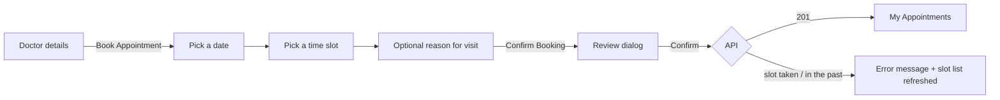
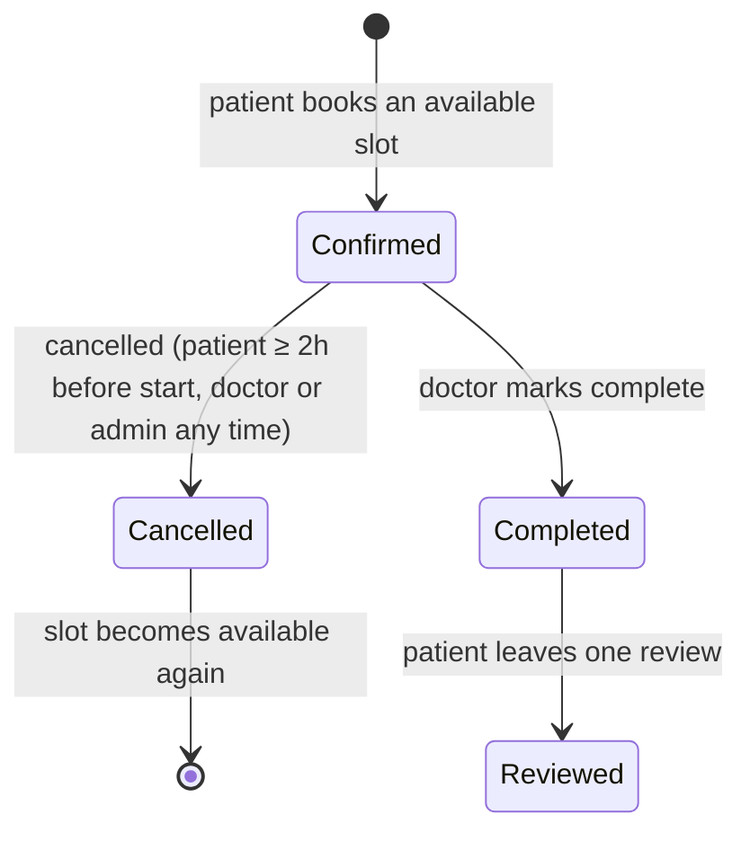

# ClinicFlow Frontend — Features

What each kind of user can do in the app, page by page, and the rules behind each feature. Page components are in `src/pages/`; routes are listed in [ARCHITECTURE.md §3](ARCHITECTURE.md#3-routing). Where a page has a known limitation, it's noted here and tracked in [KNOWN_ISSUES.md](KNOWN_ISSUES.md).

---

## Roles at a glance

| Role | How the account is created | Main pages |
|---|---|---|
| **Visitor** (signed out) | — | Landing, Find Doctors, Doctor details, Register, Sign in |
| **Patient** | Registers, then confirms their email | Book appointment, My Appointments, Profile, Notifications |
| **Doctor** | Registers, confirms their email, then waits for **admin approval** before appearing in search | Dashboard, Appointments, Schedules, Profile, Notifications |
| **Admin** | Created by the backend at startup (see [BACKEND_OVERVIEW.md](BACKEND_OVERVIEW.md)) | Dashboard, Pending doctors, Specialties, Notifications |

## Navigation

The **Navbar** (`src/components/Navbar.tsx`) sticks to the top of every page. Its main links depend on the role, and the current page is underlined:

| Role | Main navigation |
|---|---|
| Visitor | Find doctors (plus "Sign in" and "Create account") |
| Patient | Find doctors, Appointments |
| Doctor | Dashboard, Appointments, Schedule |
| Admin | Overview, Doctor approvals, Specialties |

Signed-in users also get:
- **Notification bell:** shows the unread count and lists up to 5 unread notifications with how long ago they arrived. Clicking one marks it as read and opens the related appointments page. "Mark all read" clears them, and **"View all notifications"** is always available. The unread list refreshes on navigation, when the window regains focus, every 60 seconds, and when the Notifications page changes something.
- **Account menu:** name, email and role, with Profile (patients and doctors), My appointments (patients), Notifications and Sign out.
- **Mobile menu:** a slide-in panel with the same links, Notifications (with the unread count), Profile and Sign out.

A "Skip to content" link appears on keyboard focus. The footer is full for visitors and a slim bar for signed-in users.

---

## Public pages

### Landing page — `/`
A marketing page with:
- a hero with calls to action ("Find a doctor", "Create a free account") and an illustration of the booking UI. The sample doctor in the illustration is decorative and hidden from screen readers;
- "How it works";
- what the product does for patients, doctors and clinic admins;
- trust points;
- a final call to action;
- a small "Under the hood" technology strip.

It calls no API and shows no invented statistics.

### Find a doctor — `/doctors`
- **Search by name and city.** Typing applies after a 300 ms pause; Enter or the Search button applies it straight away.
- **Filter by specialty** (active specialties from `GET /api/Specialty`).
- **Sort by** Top Rated, Lowest Fee or Most Experienced.
- **Results:** 12 doctors per page as cards showing initials, name, specialty, rating ("New" when there is none yet), city, years of experience and fee. The whole card links to the doctor's profile.
- **Paging:** previous/next. Changing any filter or the sort goes back to page 1. Next is disabled when a page comes back with fewer than 12 results.
- **States:**
  - skeleton cards while loading;
  - "No doctors match your search", with **Clear filters** when filters are set;
  - "No more doctors" on an empty later page, with paging still visible so you can go back;
  - an error message with **Try again** if the request fails.
- Only approved, active doctors are returned by the API.

### Doctor details — `/doctors/:id`
- **Header:** initials, specialty, name, average rating and review count, then fact tiles for experience, city and fee.
- **Booking card** (sticky on desktop; on mobile it sits just after the header):
  - shows the fee and address;
  - patients see **Book an appointment** (→ `/patient/book/:id`);
  - visitors see **Sign in to book**, which returns them to the booking page after signing in, plus a link to create an account;
  - doctors and admins see a note that booking is for patient accounts.
- **About:** the doctor's bio.
- **Patient reviews:** the 10 newest visible reviews, with stars, comment, patient name and date.
- **States:**
  - "Doctor not found" (404), with a link back to the list;
  - a failed request shows an error with **Try again** instead.

### Register as patient — `/register/patient`
- **Sections:**
  - **Account:** email, password;
  - **About you:** first and last name (≤ 50 characters), phone, gender, date of birth;
  - **Health & emergency contact** (optional): blood type, allergies, chronic conditions, emergency contact name and phone.
- **Password:** a live checklist shows each rule as you type: at least 8 characters, upper case, lower case, a number and a special character. Submitting is blocked until all are met.
- **Required fields** are marked with \*. Empty fields are flagged by the browser, and a missing gender gets an inline message.
- **Phone:** international format, e.g. `+201234567890`.
- **Errors:** server validation errors appear as one toast per message.
- **On success:** a "check your inbox" screen. The account can't sign in until the email is confirmed.

### Register as doctor — `/register/doctor`
- **Sections:**
  - **Account** and **About you**: the same fields as for patients;
  - **Your practice:** specialty, years of experience, consultation fee (1–10,000 EGP), bio (≤ 500 characters, with a counter), clinic address (≤ 300) and city (≤ 100).
- Gender and specialty are checked before sending, with inline messages.
- **On success:** a three-step "what happens next": confirm your email, wait for **admin approval**, then set your weekly hours.

### Sign in — `/login`
- Email and password, with an accessible show/hide toggle and a "Forgot password?" link next to the password label.
- **On success,** users return to the page they were trying to open (for example the booking page). Otherwise they go to their home page: Admin → `/admin/dashboard`, Doctor → `/doctor/dashboard`, Patient → `/patient/appointments`.
- **Errors** appear inline above the form and as a toast. They explain the cause: wrong credentials, account locked for 15 minutes after 5 failed attempts, account suspended, or email not confirmed.
- Links: create a patient account, join as a doctor.

### Forgot password — `/forgot-password`
Enter an email to receive a reset link. The page always says "If an account exists with … you will receive a link", so it never reveals whether an email is registered.

### Reset password — `/reset-password` (opened from the email)
- Reads `userId` and `token` from the link.
- Asks for the new password twice and checks that they match.
- **On success,** all of the user's sessions are signed out by the server and the page links to Sign In.
- If the link is missing its parameters, the user is sent to Forgot password.

### Confirm email — `/confirm-email` (opened from the email)
Confirms the account automatically from the link's `userId` and `token`, then shows success with a Sign In button, or "The confirmation link is invalid or has expired".

---

## Patient

### Book an appointment — `/patient/book/:doctorId`

The page is laid out as three numbered steps (date, time, reason), next to a **booking summary** card. The summary sticks on desktop and sits at the bottom on mobile. It shows the selected date, time, clinic and fee, and holds the **Review & confirm** button.

- **Date strip:** 7 days at a time, starting today, with paging up to **14 days ahead**, the window in which the backend creates slots.
- **Slots:** only *available* slots for the chosen date, grouped into Morning, Afternoon and Evening and shown as "9:30 AM". Changing the date clears the selected slot, so a slot from another day can't be booked by mistake. Date and time buttons announce their selected state to screen readers.
- **Reason:** optional, up to 500 characters with a counter.
- **Confirmation dialog:** shows the doctor, the slot's own date and time, the fee, and the reason.
- **On success** a toast appears and the user goes to My Appointments. A booking is **Confirmed** immediately; the doctor doesn't need to accept it. Both sides get a notification and the patient gets a confirmation email.
- **If someone else took the slot first,** or it has already started, the page explains why and reloads the slots.

### My appointments — `/patient/appointments`
- **List:** newest first, 10 per page. A segmented filter offers All, Confirmed, Completed and Cancelled.
- **Each card shows:**
  - a calendar date tile;
  - doctor, time range and reason;
  - a status badge (icon + text);
  - the doctor's notes (if any);
  - who cancelled, and why.
- **Cancel appointment** (Confirmed appointments): opens a dialog naming the visit, with an optional reason. Patients can cancel **up to 2 hours before** the start; after that the API refuses with an explanatory message. Cancelling frees the slot for others.
- **Leave a review** (Completed appointments not yet reviewed): a 1–5 star rating (a keyboard-accessible radio group with labels such as "Excellent") and an optional comment of up to 300 characters, with a counter. One review per appointment. The doctor's average rating updates.
- **Book an appointment** goes to Find a doctor.

### Profile — `/patient/profile`
A summary card (name, email, member since), then two tabs, each saved separately:
- **Personal:** first and last name, phone, date of birth, gender, profile picture URL (`PATCH /api/profile/me`).
- **Medical:** blood type, allergies, chronic conditions, emergency contact name and phone (`PATCH /api/patients/profile`).

If the profile fails to load, the page shows an error with **Try again** rather than an empty form, which could blank out data if saved.

Limitation: a medical field can't be cleared. Emptying it leaves the old value in place.

---

## Doctor

### Dashboard — `/doctor/dashboard`
- **Greeting** with today's date, plus quick links to Manage schedule and All appointments.
- **Stats:** today's appointments, upcoming (confirmed) appointments, and appointments completed today. They're based on the doctor's 50 most recent appointments.
- **Today's agenda:** today's appointments in time order, with patient, reason and status. A **Complete** button appears once the appointment's start time has passed.
- **Weekly availability:** all seven days, showing each day's hours, "Off", or a **Paused** label for inactive schedules. Today is highlighted.

### Appointments — `/doctor/appointments`
- **List:** newest first, 10 per page. A segmented filter offers All, Confirmed, Completed and Cancelled. "Pending" was removed because the backend never uses it.
- **Mark as completed:** offered for Confirmed appointments **after their start time**, with a confirmation dialog naming the patient. Completing lets the patient leave a review.
- **Add / Edit notes:** clinical notes on Confirmed or Completed appointments. The patient can see them.

There is no cancel button for doctors yet, although the API allows doctors to cancel.

### Schedules — `/doctor/schedules`
A doctor's weekly availability. Each schedule defines one weekday's working hours and slot length, and the backend turns it into bookable slots for the **next 14 days**.

- **Seven-day list:** each day shows its hours, slot length, how many slots that makes, and an **Active** or **Paused — not bookable** badge, or "Not available".
- **One schedule per weekday.** "Add hours" appears only on days without one and opens the dialog with that day already chosen. The dialog's day list only offers free days, and the header's "Add hours" is disabled once all 7 days are set.
- **Slot length:** 10, 15, 20, 30, 45, 60, 90 or 120 minutes. The dialog previews how many slots the hours produce.
- **Validation before saving:** both times are required, the end must be after the start, and the window must fit at least one slot. The error appears in the dialog and the save button stays disabled until it's fixed.
- **Edit:** change the hours, slot length or **Accept bookings** switch (pause a day without deleting it). Saving regenerates future *available* slots. Booked slots are kept. A paused schedule produces no slots.
- **Delete:** removes the schedule and stops slot generation for that day. The backend may refuse if past appointments used its slots.

### Profile — `/doctor/profile`
- **Personal tab:** the same fields as the patient's personal tab.
- **Practice tab:** consultation fee, bio (with a counter), clinic address and city.
  - The **fee is required** on every save (more than 0, at most 10,000 EGP).
  - The tab starts empty because the API has no endpoint that returns a doctor's own professional details. **Blank fields keep their current values.**

---

## Admin

### Dashboard — `/admin/dashboard`
- **Approvals banner:** shown when doctors are waiting, linking to the approvals page.
- **Six counters:** doctors, patients, appointments, reviews, specialties, pending approvals.
- **Appointments by status:** a donut chart with the completion rate in the center, plus a text legend that doubles as the accessible version, listing each status's count and percentage.
- **Rates:** completion and cancellation rate.
- **Quick actions:** Review pending doctors and Manage specialties.

The numbers load once, when the page opens. If they fail to load, the page shows an error with **Try again**.

### Doctor approvals — `/admin/pending-doctors`
Doctors waiting for approval, as a table on desktop and cards on mobile: name, specialty, city, experience and fee.
- **Approve:** the doctor appears in search and is notified.
- **Reject:** **suspends** the account, which deactivates it so the doctor can't sign in. The confirmation dialog says this explicitly.

Both actions ask for confirmation first.

### Specialties — `/admin/specialties`
- **List:** all specialties, including inactive ones, with an Active/Inactive badge and a count in the page description.
- **Add / Edit:** name (required, ≤ 100 characters, must be unique), description (≤ 500, with a counter), icon URL (an absolute URL, optional). Enter submits the form.
- **Delete:** with confirmation. The API refuses if any doctor uses the specialty.

---

## Shared features

### Notifications — `/notifications`
- **Inbox:** every notification, newest first, with an icon per type (reminder, confirmed, cancelled, completed, system) and a relative time ("3 hours ago"; hover for the exact time). Unread items are highlighted and announced as "Unread" to screen readers.
- **Filter:** All or Unread.
- **Actions:** mark one as read (✓, labelled with the notification's title), or "Mark all as read". Both refresh the Navbar bell.

The backend creates notifications for bookings, cancellations, completions, reminders (24 hours before), and doctor approval or suspension.

**There's no real-time push.** The Navbar refreshes unread notifications on navigation, on window focus and every 60 seconds (see [Navigation](#navigation)).

### Appointment lifecycle

`Pending` and `NoShow` exist in the API's status list, but the backend never sets them today.

### Email-driven flows

| Email | Sent when | Link opens | What happens |
|---|---|---|---|
| Confirm your email | Registration | `/#/confirm-email?userId=…&token=…` | The account is confirmed and can sign in |
| Reset your password | Forgot password | `/#/reset-password?userId=…&token=…` | The user sets a new password; all sessions are revoked |
| Appointment confirmed | Booking | — | Informational |
| Appointment reminder | About 24 hours before | — | Informational (hourly background job) |

### Sessions
Signing in keeps the user signed in across page reloads for up to 7 days of inactivity. Access tokens renew silently in the background. A rejected session (expired, revoked, account suspended or password reset) signs the user out and sends them to the sign-in page. Temporary server or network problems don't sign the user out. Details are in [ARCHITECTURE.md §5](ARCHITECTURE.md#5-authentication-and-session).
